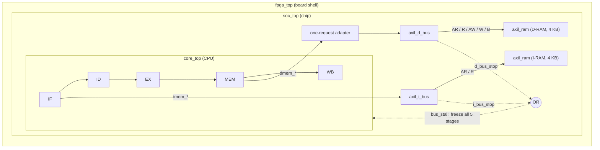

# rv32i-tapeout-soc

A hand-written RV32I SoC, from a single-cycle core to silicon. The plan is a 5-stage pipelined core on AXI4-Lite with caches, M-mode CSRs and peripherals, running FreeRTOS on an Artix-7 FPGA and taped out through Tiny Tapeout (SkyWater 130 nm). See [ROADMAP.md](ROADMAP.md) for the full plan.

## Status

| Phase | Scope | Status |
| --- | --- | --- |
| 1 | 5-stage pipeline, forwarding, hazard detection | ✅ 38/38 `rv32ui` ISA tests |
| 2 | AXI4-Lite buses, MMIO, UART, bare-metal C | 🚧 Buses and RAMs done; UART next |
| 3 | M-mode CSRs, CLINT, FreeRTOS | ⏳ |
| 4 | 2-way I/D caches, AXI4 burst | ⏳ |
| 5 | FPGA bring-up, OpenLane signoff | ⏳ |

Today every instruction fetch, load and store goes over AXI4-Lite, and the core still passes all 38 `rv32ui` tests (`fence_i` is skipped: I-RAM and D-RAM are separate).

## Architecture



- **`core_top`** holds only the pipeline. It has no memory and exposes a fetch port (`imem_*`) and a data port (`dmem_*`).
- **`soc_top`** is the chip: the core, the two AXI4-Lite masters, two AXI4-Lite RAMs, and later the peripherals. The simulator, `fpga_top` and a future Tiny Tapeout wrapper all instantiate it.
- **Global bus stall.** While either bus is busy, every pipeline register is frozen and flush is masked, so a branch in EX survives a slow fetch.
- **One bus request per load/store.** Both buses share one stall, so a fast data bus could repeat the same access while the pipeline waits on fetch. A small adapter in `soc_top` (`dmem_done` flag, read-data hold register, selector) prevents that. This matters for MMIO, where a repeated write prints a character twice.

## Repository layout

```text
rtl/
  soc_top.v        chip top
  core/            pipeline (IF/ID/EX/MEM/WB, forwarding, hazard unit)
  bus/             axil_i_bus, axil_d_bus (AXI4-Lite masters)
  mem/             axil_ram (AXI4-Lite slave); inst_mem/data_mem are legacy
fpga/              fpga_top.v (board shell)
verif/
  lv0/             Verilator C++ testbench for the full SoC
  isa/             rv32ui test binaries
  cocotb/          unit tests for axil_d_bus and axil_ram
  run_all.py       ISA regression runner
milestones/        one folder per milestone: waveform + short write-up
```

## Running the tests

Requirements: Verilator ≥ 5, Python venv in `.venv/` with `cocotb` and `cocotbext-axi`, and `riscv-none-elf-gcc` only if you rebuild the ISA binaries. Run everything from the repository root.

ISA regression on the full SoC:

```bash
make -C verif/lv0 build && .venv/bin/python verif/run_all.py
```

Each line shows the cycle count and a data-bus scoreboard:

```text
[37/39] rv32ui-p-sw   [PASS] (cycle  1060)  rd 34/34  wr 34/34  extra +0
```

`rd 34/34` means 34 bus reads for 34 executed loads. `extra` must be `+0`; anything else means an instruction hit the bus more than once.

Unit tests for the bus blocks:

```bash
make -C verif/cocotb/axil_d_bus
make -C verif/cocotb/axil_ram
```

Waveforms: `make -C verif/lv0 wave` or `make -C verif/cocotb/<module> wave` (Surfer).

## Testbench safeguards

- `a0` is poisoned with `0xDEADBEEF` before the run, so a simulation that stops early cannot report PASS.
- A PC that is frozen for 1000 cycles is reported as `[TEST HANG]`.
- `axil_ram` has a `DBG_DELAY` parameter that delays `rvalid`. Setting different delays on the I-RAM and D-RAM is how the repeated-access bug was found.

## Milestones

| Date | Milestone |
| --- | --- |
| 2026-10-19 | Single-cycle core passes 38/38 ISA tests |
| 2026-10-19 | 5-stage pipeline passes 38/38 ISA tests |
| 2026-10-24 | AXI4-Lite data-bus master passes its first write/read-back |
| 2026-10-25 | AXI4-Lite RAM slave passes multi-address tests |
| 2026-10-31 | Whole SoC runs over AXI4-Lite, 38/38, one bus request per load/store |

Details and waveforms are in [milestones/](milestones/).
