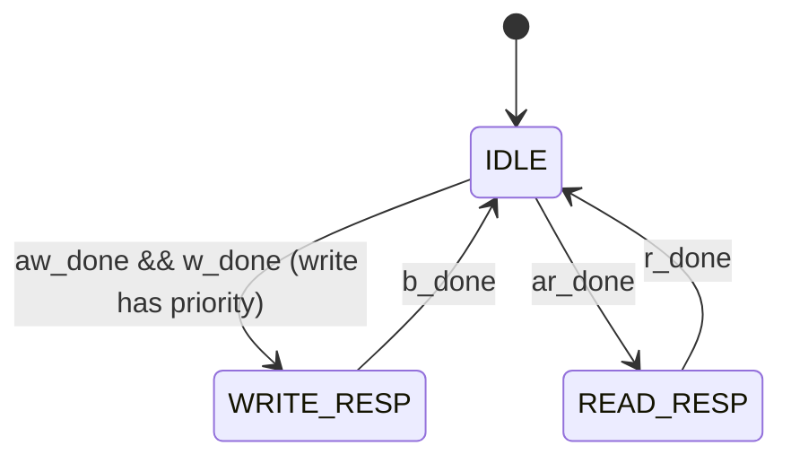

**2026-10-25 12:39** — Hand-written 3-state AXI4-Lite RAM slave (accepts AW+W together, write-priority arbitration, byte-strobe BRAM writes) passes multi-address write/read-back against a cocotb AXI-Lite master in Verilator (`wave.vcd`, commit `5b69570`).

