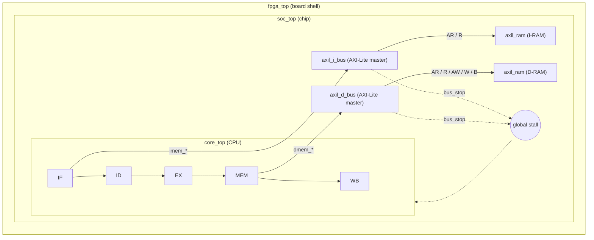

**Status: 🚧 IN PROGRESS — Stage 1 of 3 done**

**2026-10-25** — Integrate the AXI4-Lite buses and RAMs into the 5-stage RV32I core through a new chip-level `soc_top`, keeping all 38/38 `rv32ui` ISA tests passing (`wave.vcd`: latest completed stage, `rv32ui-p-add`).

| Stage | Goal | Status |
| --- | --- | --- |
| 1 | Move `inst_mem` / `data_mem` out of `core_top` into `soc_top` (no AXI yet) | ✅ Done |
| 2 | Replace them with `axil_i_bus` / `axil_d_bus` + two `axil_ram`, add global bus stall | ⏳ |
| 3 | 38/38 ISA tests pass over AXI-Lite | ⏳ |

## Movements

- **2026-10-25 15:21** — Stage 1: added `rtl/soc_top.v`; `core_top` now exposes `imem_*` / `dmem_*` ports; `fpga_top` and the Verilator testbench use `soc_top` as top. ISA regression 38/38 (commit pending).
