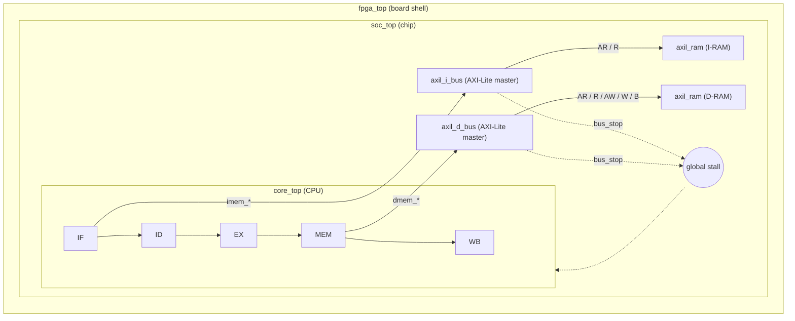

**Status: 🚧 IN PROGRESS — Stage 1 of 3 done**

**2026-10-25** — Integrate the AXI4-Lite buses and RAMs into the 5-stage RV32I core through a new chip-level `soc_top`, keeping all 38/38 `rv32ui` ISA tests passing (`wave.vcd`: latest completed stage, `rv32ui-p-add`).

## Why this architecture

The CPU core contains no memory. It only exposes two ports: `imem_*` (fetch) and `dmem_*` (load/store). Everything else lives one level up, in `soc_top`.

- **Swap memories without touching the CPU.** BRAM today, AXI-Lite RAM in Stage 2, caches in Phase 4: only `soc_top` changes.
- **One chip, many shells.** Simulation, `fpga_top` (Artix-7) and a future Tiny Tapeout wrapper all instantiate the same `soc_top`, so what passes in simulation is what goes on the board.
- **Add peripherals the same way.** A UART or timer is just another AXI-Lite slave behind the bus; the core never knows it exists.
- **Same shape as real cores.** Ibex and PicoRV32 also keep memory outside the core and expose a simple fetch/data interface.

## Stages

| Stage | Goal | Status |
| --- | --- | --- |
| 1 | Move `inst_mem` / `data_mem` out of `core_top` into `soc_top` (no AXI yet) | ✅ Done |
| 2 | Replace them with `axil_i_bus` / `axil_d_bus` + two `axil_ram`, add global bus stall | ⏳ |
| 3 | 38/38 ISA tests pass over AXI-Lite | ⏳ |

## Movements

- **2026-10-25 15:21** — Stage 1: added `rtl/soc_top.v`; `core_top` now exposes `imem_*` / `dmem_*` ports; `fpga_top` and the Verilator testbench use `soc_top` as top. ISA regression 38/38 (commit `e98a8be`).
- **2026-10-25 16:40** — Stage 2a: added `bus_stall_i` to `core_top`; it freezes every pipeline register and masks flush (flush has priority over stall inside the pipe registers). Tied to 0 for now; ISA regression still 38/38.
- **2026-10-25 18:01** — Stage 2b-1: instruction fetch now runs over AXI-Lite (`axil_i_bus` + `axil_ram` I-RAM); IF/ID and MEM/WB became real registers (the hidden BRAM output register and `flush_d` are gone). ISA regression 38/38, cycle count ×2 as expected (`rv32ui-p-add`: 466 → 932).
